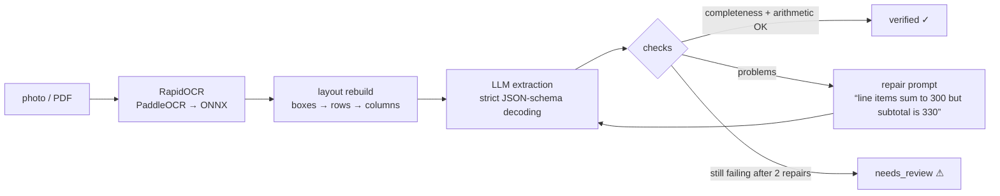

# receipt-reader

**Turn photos and PDFs of receipts and invoices into clean, validated JSON, fully offline.** OCR runs on ONNX, extraction runs on a small local LLM, and every result is **cross-checked like an accountant would**. Line items must add up to the subtotal and subtotal + tax must equal the total. If anything doesn't reconcile, the model is told exactly what's wrong and tries again. Documents it still can't reconcile are flagged `needs_review`, never silently passed.

  

<!-- author-banner -->
> **Project 07 of 20** in my AI build series, designed and built by **[Abbishekk DGS](https://abbishekkdgs.tech)**. [See all projects →](https://github.com/Abbishekk-DGS)

## Example

Input: a blurred, slightly rotated photo of a restaurant bill (`receipt-reader sample` generates it). Output, `qwen2.5:3b`, first attempt, 11.7 s:

```json
{
  "status": "verified",
  "document": {
    "vendor": "SARAVANATIFFINCENTRE",
    "document_type": "invoice",
    "invoice_number": "ST-20481",
    "date": "2026-09-14",
    "currency": "INR",
    "line_items": [
      {"description": "Masala Dosa", "quantity": 2, "unit_price": 90.0, "amount": 180.0},
      {"description": "Filter Coffee", "quantity": 3, "unit_price": 40.0, "amount": 120.0},
      {"description": "Medu Vada", "quantity": 1, "unit_price": 60.0, "amount": 60.0},
      {"description": "Paneer Butter Masala", "quantity": 1, "unit_price": 240.0, "amount": 240.0},
      {"description": "Butter Naan", "quantity": 4, "unit_price": 45.0, "amount": 180.0}
    ],
    "subtotal": 780.0,
    "tax": 39.0,
    "total": 819.0,
    "payment_method": "UPI"
  }
}
```

Every number matches the ground truth. Tax correctly sums CGST + SGST. (The OCR model drops spaces in some all-caps headings, hence the vendor spelling.)

## Pipeline



## What makes it reliable

1. **Layout reconstruction.** OCR returns text boxes in arbitrary order. receipt-reader clusters them into visual rows by vertical centre, then places words by x-position, so `Masala Dosa … 2 … 90.00 … 180.00` stays on one line. Without this, the LLM can't tell which price belongs to which item.
2. **Strict decoding schema.** The Pydantic schema is handed to Ollama's constrained decoder with every field marked *required* and `line_items` needing at least one entry. We measured this: with optional fields, `qwen2.5:3b` skipped line items, subtotal and bill number even after 3 attempts. With the strict schema it filled everything on the first try.
3. **Completeness checks.** If the OCR text says "Subtotal" or "Bill No" and the field is empty, that's an error. This catches the failure arithmetic alone can't: an empty extraction trivially "adds up".
4. **Arithmetic checks.** qty × unit price = amount, Σ items = subtotal, subtotal + tax − discount = total, within 2% (min 1 unit) for printed rounding.
5. **Repair loop.** Problems go back to the model in plain language, up to 2 repairs.

## Quickstart

```bash
ollama pull qwen2.5:3b         # https://ollama.com

git clone https://github.com/Abbishekk-DGS/receipt-reader && cd receipt-reader
uv sync

uv run receipt-reader sample                                   # synthetic test receipt
uv run receipt-reader samples/receipt.png --show-text          # see the rebuilt OCR layout
uv run receipt-reader ~/Documents/bills --csv expenses.csv     # batch → spreadsheet
```

Results go to `outputs/<name>.json`. Works with JPG, PNG, WEBP, TIFF and multi-page PDFs.

## Development

```bash
uv sync --extra dev && uv run pytest -q
```

Tests cover row reconstruction, arithmetic and completeness checks, the repair loop (with a scripted LLM), the strict schema, and real OCR on a rendered receipt.

## About the author

Built by **Abbishekk DGS**. More of my work at **[abbishekkdgs.tech](https://abbishekkdgs.tech)** and on **[GitHub](https://github.com/Abbishekk-DGS)**.

## License

MIT © Abbishekk DGS
